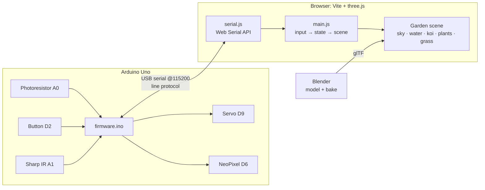

# Blooming Garden

**A shy, living garden you grow with your hands.** Blooming Garden is a physical-to-web art piece: an Arduino with real sensors drives a hand-built 3D garden in the browser, and the garden talks back to the hardware. Light sets the time of day, reaching toward the sensor makes the plants flinch and the koi scatter, and pressing a button plants a seed that grows while the camera flies in to watch it bloom.

> In the browser the scene is titled **Shy Garden**: the plants are shy, the garden blooms.

---

## Demo

> 🎬 **Demo video coming soon.**
>
> <!-- Replace with the video embed / link once recorded, e.g.:
> [](https://youtu.be/XXXXXXXX)
> -->

Suggested shots for the demo:
1. Wide shot of hardware + screen side by side.
2. Cover the light sensor: dusk falls, the sun sets behind the island, the moon rises, the lantern lights up, fireflies appear.
3. Reach toward the IR sensor: the plants recoil, the grass bows away, the koi flee with a splash.
4. Press the button: a seed sprouts, the camera flies in and follows the stem as it blooms, and the LED changes to the flower's colour.
5. Close-up of the servo sundial tracking the sun.

---

## What it does

| You do | The garden does | The hardware does |
|---|---|---|
| **Change the light** on the photoresistor | Time of day: sky gradient, sun/moon arc, clouds, stars. Flowers open and glow in light and close into buds at night. Lantern and fireflies come out after dark. | **Servo** acts as a sundial, sweeping 0–180° with daylight |
| **Reach toward** the IR distance sensor (10–50 cm) | Plants recoil and fold their leaves, grass bows away, koi scatter with a splash, camera leans in | (none) |
| **Press the button** | Plants a seed in a free spot: it grows, blooms, and the **bloom cam** flies in to watch | **NeoPixel LED** lights up in the new flower's colour |

Always-on ambient life, independent of the sensors: drifting clouds, a turning star field, shooting stars, swimming koi with wakes and bubbles, wind gusts rolling through the grass, and an idle camera orbit.

---

## How it works



### 1. Firmware (Arduino)
`firmware/firmware.ino` samples the sensors every 33 ms (~30 Hz) and prints one line per snapshot. It listens for commands on the same port. No `delay()` in the loop: timing uses `millis()`, so reading and writing happen together. Incoming bytes are assembled into a fixed `char` buffer (not `String`) to avoid heap fragmentation on the Uno's 2 KB of RAM. On boot the LED flashes red → green → blue as a self-test, then the board prints `READY`.

### 2. Serial protocol
Plain text, one message per line, 115200 baud:

| Direction | Message | Meaning |
|---|---|---|
| Board → Browser | `READY` | Boot finished (the Uno resets when the port opens) |
| Board → Browser | `L:<0-1023>,B:<0\|1>,D:<cm>` | Light, button, distance (`D:0` = nothing in range) |
| Browser → Board | `S:<0-180>` | Servo angle |
| Browser → Board | `C:<r>,<g>,<b>` | LED colour, 0–255 each |

### 3. Web Serial bridge
`controller/src/serial.js` opens the port with the browser's **Web Serial API**, decodes the stream, splits on `\n` while holding the incomplete tail for the next chunk, and rejects corrupted lines with a regex. It waits for `READY` (with a 2.5 s fallback) before sending, and cleans up on unplug.

### 4. From sensor numbers to garden behaviour (`main.js`)
- **Light** auto-calibrates: it stretches the min/max it has actually seen to 0–1, because a real room never spans the full 0–1023.
- **Distance** maps 10 cm → 1.0 ("hand right there") down to 50 cm+ → 0.
- **Smoothing**: daylight drifts slowly, like a real dusk, while nearness reacts fast, like a flinch. Both use frame-rate-independent exponential smoothing.
- **Button** is edge-detected, so holding it plants one seed, not sixty.
- Hardware and the mouse/keyboard simulator write into the **same input object**, so the scene never knows which one is driving it.

### 5. The 3D pipeline (Blender → glTF → three.js)
Static, heavy geometry is authored in Blender. Anything that must react to sensors is built live in code.

| Asset | Made in | Notes |
|---|---|---|
| Ground diorama, pond basin, soil cross-section | Blender (Python) | All-quad disc via squircle mapping, 10,368 quads, pond carved by a signed-distance function |
| 29 rim stones, 5 stepping stones, 5 boulders | Blender | Subdivided-cube base with layered noise for weathered granite; all quads |
| Stone lantern (tōrō) | Blender | 214 quads, recessed windows on their own material so they can glow at night |
| Koi | Blender | 20 edge loops along the spine so the body bends smoothly when it swims; forked tail, fan pectorals |
| Leaf, petal | Blender | Small curved quad grids, instanced by code to build every plant |
| Plants, grass, water, sky, bubbles, fireflies | three.js | Must react to sensors in real time |

**Topology audit.** Every mesh was checked numerically: zero triangles, zero faces with more than 4 sides, no edges shared by 3+ faces, no stray vertices, consistent face winding. Wireframe renders were reviewed and fixed over several rounds. For example, the first koi was too thin and its fin roots collapsed into triangles, so it was rebuilt.

**Baking.** Albedo (colour) and ambient occlusion were baked in Cycles into 2048² textures (1024² for the lantern). The ground's UV layout was repacked from 52% to 73% texture coverage before the final bake. Full lighting is deliberately *not* baked: the light sensor changes the time of day live, so the sun and moon are real-time lights, and the baked AO supplies the soft contact shading.

**Export.** `garden.glb` (2.3 MB: ground, stones, lantern, 26 planting-spot markers, baked textures) and `assets.glb` (25 KB: koi, leaf, petal). Blender's Z-up converts to three.js Y-up. The pond's shape is duplicated in JS/GLSL (`terrain.js`) so code and mesh agree exactly.

### 6. Scene systems (`controller/src/garden/`)
- **Sky**: gradient dome with three keyframes (night, dusk, day); a sun and a cratered moon on light-driven arcs (the sun sets behind the island around 30% light); fbm clouds tinted by time of day; a slowly turning, twinkling star field; shooting stars at night. The arcs scale with window width so the sunset never happens off-screen.
- **Water**: analytic wave normals, fresnel, sun glint, cartoon shore foam, plus koi wakes and expanding rings computed per pixel from uniform arrays.
- **Koi**: steering behaviours (wander, stay in the pond, keep apart, flee the hand), a body wave in the vertex shader, procedural kohaku/sanke/showa/ogon patterns, caustic light on their backs, surface "kisses" that leave rings, and startle splashes.
- **Plants**: S-curved tube stems revealed bottom-up while growing, golden-angle leaves, radial petals that open with light, and a shy recoil that leans away from the viewer.
- **Ground cover**: four instanced layers (textured lawn, tall wild grass, clover, wildflowers) placed by noise masks so they form natural patches. Placement skips rocks by querying a height field of the stone mesh. Wind and hand-push are computed in world space, then mapped back into each blade's rotated space.
- **Look**: toon shading (4-band ramp), inverted-hull ink outlines that turn blue at night, bloom, ACES tone mapping, and a saturation/contrast grade.
- **Bloom cam**: on each new seed, the camera glides to the plant, tracks the growing stem tip, holds on the open flower, then eases back to the wide shot.

---

## Hardware

### Components
| Part | Used for |
|---|---|
| Elegoo Uno R3 (Arduino Uno compatible) | Microcontroller |
| Half-size breadboard + jumper wires | Wiring |
| Photoresistor (LDR) + 10 kΩ resistor | Light sensor (voltage divider) |
| Tactile pushbutton | Seed button (uses the internal pull-up) |
| Sharp GP2Y0A21YK0F IR distance sensor | Hand proximity, 10–80 cm |
| Micro servo (SG90 class) | Sundial |
| WS2812B addressable RGB LED (NeoPixel) | Bloom colour |
| 330 Ω resistor (optional) | Series resistor on the LED data line |

> The large MG996R-class servo draws more current than USB can supply and kept resetting the board, so a micro servo is used. A big servo needs its own 5 V supply with ground shared with the Uno.

### Wiring
| Part | Connection |
|---|---|
| Power rails | Uno **5V → + rail**, Uno **GND → − rail** |
| Photoresistor | + rail → LDR → **A0** junction → 10 kΩ → − rail |
| Button | Straddles the centre gap; one leg → **D2**, diagonal leg → − rail |
| IR sensor | Red → + rail, black → − rail, yellow → **A1** |
| Servo | Brown/black → − rail, red → + rail, orange/yellow/white → **D9** |
| NeoPixel | +5V → + rail, GND → − rail, **DIN** → (330 Ω) → **D6** |

> Wire the LED's data line from the board's **DIN** pad, not **DO**.

---

## Getting started

### 1. Flash the firmware
1. Install the [Arduino IDE](https://www.arduino.cc/en/software).
2. Library Manager → install **Adafruit NeoPixel** (Servo is built in).
3. Open `firmware/firmware.ino`, select **Tools → Board → Arduino Uno** and the `usbmodem`/`usbserial` port, then click **Upload**.
4. Optional check: open the Serial Monitor at **115200 baud** with line ending **Newline**. You should see `READY`, then `L:…,B:…,D:…` streaming. Type `S:180` or `C:255,0,0` to test the outputs.

### 2. Run the web app
```bash
cd controller
npm install
npm run dev
```
Open the printed `localhost` URL in **Chrome or Edge** (Web Serial isn't available in Safari or Firefox).

### 3. Connect
**Close the Arduino Serial Monitor first** (only one program can hold the port), then click **Connect device** and choose the Uno. The tag switches from **SIM** to **LIVE**.

### No hardware? Simulated mode
| Input | Simulates |
|---|---|
| Mouse up/down | Daylight |
| Scroll wheel | Reaching toward / away from the IR sensor |
| Click or hold **Space** | Seed button |
| **R** | Reset light calibration |

### URL parameters
Pin a state on load, useful for screenshots and demo recordings:
- `?day=0.0` (night) … `?day=0.3` (sunset) … `?day=1.0` (noon)
- `?near=1` (hand right at the sensor)

### Dev hook
While running `npm run dev`, `window.shy` in the browser console exposes the input state, bloom cam, garden, koi, water and bubbles for testing. It is stripped from production builds.

---

## File structure

```
arduino/
├── README.md
├── .gitignore
├── firmware/
│   └── firmware.ino            # Uno: sensors → serial, serial → servo + LED
├── controller/                 # web app (Vite + three.js)
│   ├── index.html              # canvas + HUD
│   ├── package.json
│   ├── public/
│   │   └── models/
│   │       ├── garden.glb      # baked ground, stones, lantern, planting spots
│   │       └── assets.glb      # koi, leaf, petal
│   └── src/
│       ├── main.js             # input + calibration, render loop, bloom cam, HUD, serial wiring
│       ├── serial.js           # Web Serial transport + line protocol
│       ├── style.css           # HUD styling
│       └── garden/
│           ├── terrain.js      # pond SDF (JS + GLSL), ground height field
│           ├── sky.js          # sky dome, sun/moon, clouds, stars, shooting stars, lights
│           ├── water.js        # pond surface, foam, koi wakes, ripple rings
│           ├── koi.js          # koi school: steering, swim shader, patterns, caustics
│           ├── bubbles.js      # cartoon bubbles that pop into rings
│           ├── plants.js       # shy plants: growth, bloom, recoil
│           ├── grass.js        # lawn, tall grass, clover, wildflowers
│           ├── fireflies.js    # night fireflies
│           └── toon.js         # toon ramp, ink outlines, colour grade
└── blender/
    ├── garden.blend            # source scene (procedural materials kept for re-baking)
    ├── textures/               # baked albedo + AO maps
    └── renders/                # topology / preview renders from modelling
```

---

## Troubleshooting

| Symptom | Cause / fix |
|---|---|
| `Failed to open serial port` | Another program holds the port. Close the Arduino Serial Monitor/Plotter and other tabs running the app; unplug and replug the USB if needed. |
| Board keeps resetting / disconnecting when the servo moves | The servo is drawing too much current. Use a micro servo, or power the servo separately with a shared ground. |
| Button stuck at `B:1` | Something else shares the button's breadboard row, or the button is rotated. Every hole in a row is connected. |
| Serial Monitor commands do nothing | Set the line ending to **Newline**; the firmware acts on `\n`. |
| LED stays dark | Data wire on **DO** instead of **DIN**, loose stranded wire tips, or the data row isn't connected to D6. |
| `D:` always 0 | IR sensor not powered, or nothing within ~80 cm. Closer than 10 cm reads as far away (the sensor's limit). |

---

## Future work
- **Pressure input**: an HX711 amplifier + load cell is on hand for a squeeze/press interaction (needs headers soldered).
- **Enclosure**: a laser-cut housing for the sensors so the piece reads as an object, not a breadboard.
- Deploy a simulated-mode build to the web for the portfolio.

---

## Credits
Built by Angelo with Claude (Anthropic). Uses [three.js](https://threejs.org/), [Vite](https://vitejs.dev/), [Adafruit NeoPixel](https://github.com/adafruit/Adafruit_NeoPixel), and [Blender](https://www.blender.org/).
